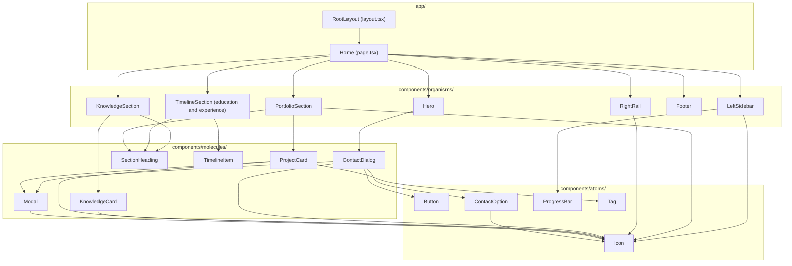

# Felipe Cadavid Portfolio

A responsive English-language resume and portfolio built with Next.js, React, TypeScript, and Tailwind CSS.

## Run locally

Requires Node.js 20.9 or later.

```sh
npm install
npm run dev
```

Open http://localhost:3000. Validation and production commands:

```sh
npm run lint
npm run build
npm start
```

## Design

The supplied reference guides the white hero, pale gray background, yellow accents (although this was changed), centered headings, rectangular cards, education rows, and social links. Inter is bundled locally through `@fontsource/inter`; no external font service is needed.

At desktop widths, the layout has a full-height skills sidebar, main content, and a social rail. At tablet widths, the skills remain beside the content and social links move below. On phones below 600px, a Profile & skills menu starts collapsed and expands on demand. The sidebar stays visible at larger widths, regardless of the mobile menu state.

CSS variables and responsive layouts are in `app/globals.css`. Components follow an atoms / molecules / organisms structure, composed by `app/page.tsx`. Content, dialogs, accessibility labels, metadata, and document language are English; institution names retain their proper names.

## Component structure

The diagram shows the project's components grouped by directory. Arrows point from a component to the components it renders, including those passed as children. Next.js wraps the home page with `RootLayout` from `app/layout.tsx`.



`ContactDialog` renders two `ContactOption` instances: LinkedIn and email. Shared components appear once in the diagram even when several parents use them. Framework components such as Next.js `Image` and native HTML elements are omitted.

## Verification

Run lint and a production build. In the browser, check desktop, tablet, and phone widths; visible language and programming progress bars; local Inter font loading; contact and project dialogs; portfolio scrolling; and absence of page-wide horizontal overflow.
